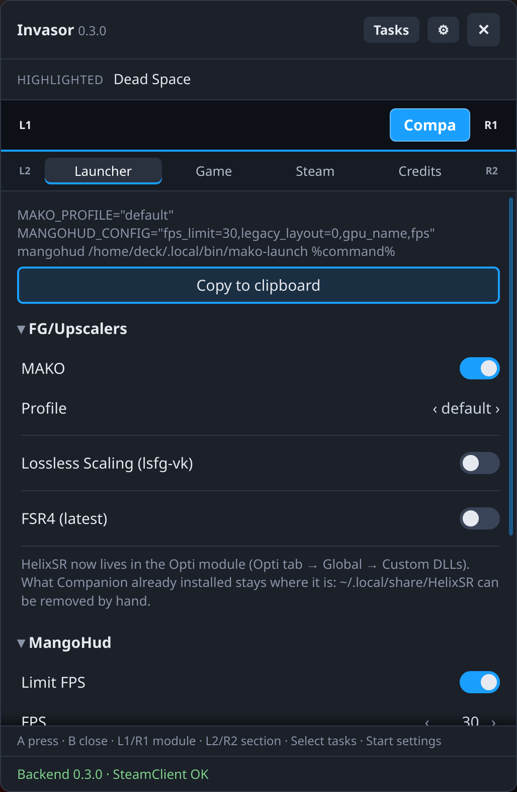
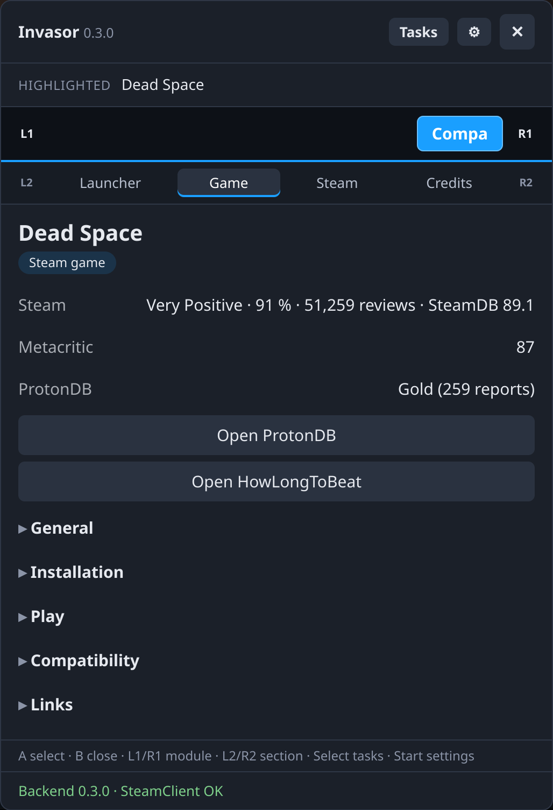
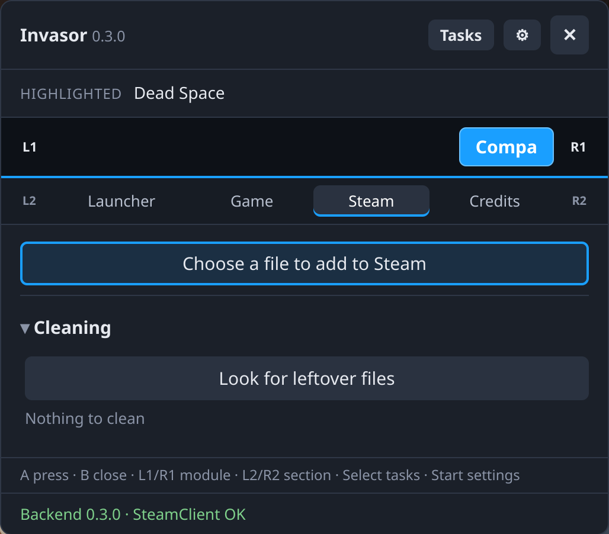

# Companion

[English](README.md) · **Español**

Un módulo para [Invasor](../invasor) que **construye las opciones de lanzamiento de Steam de un juego** (`VAR=valor … mangohud mako-launch %command%`) desde el panel, con el mando, y las copia al portapapeles. Pega el resultado en Propiedades › General › Opciones de lanzamiento del juego. Añade una pestaña **Compa** (que no aparece en el Acceso rápido) con cuatro páginas:

- **Launcher** (Lanzador): una vista previa en vivo del comando y un botón *Copiar* arriba, y después las opciones en secciones: FG/escaladores (MAKO, lsfg-vk, FSR 4), MangoHud (límite de FPS, API y FPS), gráficos (wined3d, Zink, HDR, Direct3D), Proton (compatibilidad de 32 bits, large address aware, esync/fsync, PROTON LOG = `PROTON_LOG=1` al principio de todo el comando, para que Proton deje `~/steam-<AppID>.log`, prefijo elegido en un explorador de carpetas que empieza en `compatdata` y puede ir a cualquier sitio), entorno (DLL overrides, «no es una Steam Deck» = `SteamDeck=0`, variables personalizadas) y *Restablecer todo*. Las combinaciones incompatibles o vacías muestran un aviso. Las elecciones no se guardan: se restablecen al recargar la pestaña. MAKO y lsfg-vk se excluyen entre sí: al activar uno se desactiva el otro. Su perfil se elige con ←→ entre los instalados en este equipo (los nombres `[[profile]]` de `~/.config/mako-render/conf.toml` y `~/.config/lsfg-vk/conf.toml`, o de `$MAKO_CONFIG` / `$LSFGVK_CONFIG`), leídos al abrir la pestaña; si no se encuentra ninguno (no instalado, o el fichero no se puede leer), se escribe a mano. HelixSR se ha movido al módulo [Opti](https://github.com/Gamemode-Invasor/invasor-opti) (pestaña Opti → Global → Custom DLLs), y la sección de escaladores lo dice donde estaba su interruptor. Lo que instalaron versiones anteriores de Companion no se toca: los juegos con HelixSR Scaler en su prefijo lo conservan, y `~/.local/share/HelixSR/` se puede borrar a mano.
- **Game** (Juego): todo lo que los archivos de Steam dicen del juego actual (la página abierta; si no, el resaltado; si no, el que se está ejecutando), agrupado en secciones: general, instalación (biblioteca, carpeta, tamaño, estado, compilación, actualizaciones), juego (última partida, tiempo de juego, opciones de lanzamiento, que se le piden al propio Steam si responde y si no se leen de sus archivos), compatibilidad (herramienta, prefijo) y, para los accesos directos que no son de Steam, su ejecutable, directorio de inicio y etiquetas, además de los enlaces a la tienda y a SteamDB. Al pulsar una fila se copia su valor (también el AppID). Bajo el título, *Enriquecedores* consulta las notas del juego, sin claves ni cuentas: las reseñas de Steam (valoración, porcentaje de positivas y nota SteamDB, con los recuentos de SteamSpy), Metacritic (de la tienda de Steam) y el nivel de ProtonDB; un juego que no es de Steam se busca en la tienda de Steam por su título y se muestra la coincidencia. Debajo, *Abrir ProtonDB* (la página del juego, o una búsqueda por título si no es de Steam) y *Abrir HowLongToBeat* (una búsqueda por título: HLTB no tiene API pública para leer las horas) se abren en el navegador de Steam.
- **Steam**: elige cualquier archivo (el selector de archivos de Invasor, que empieza en tu carpeta personal; con cualquier extensión) y pulsa *Añadir a Steam*. Invasor lo añade como juego que no es de Steam con el nombre del archivo (sin la extensión), sin diálogo de confirmación, y Steam muestra una notificación; si ya hay un acceso directo a ese archivo, se deja como está. Debajo, una sección plegada **Limpieza** lista las carpetas `compatdata`/`shadercache` de juegos que ya no están instalados (en todas las bibliotecas) y las imágenes de `userdata/*/config/grid` que no son de ningún juego ni acceso directo. Todo viene marcado; tú eliges y confirmas, y solo se borran elementos de un análisis recién hecho. Los nombres de los juegos se recuerdan en los datos del módulo (`ctx.data`, se actualizan en cada inicio de Steam; el `names.json` de versiones anteriores se pasa ahí y se borra) para que una carpeta sobrante diga qué era.
- **Credits** (Créditos): el autor.

Los textos siguen el idioma de Steam (español o inglés). La lógica es un port del lanzador Companion de `../companion`; solo construye el texto y nunca toca los ficheros del juego.

## Capturas

<p align="center">
  
  
  
</p>

## Requisitos
Invasor 0.3.0 o posterior (`min_core`): usa `ctx.events`, `ctx.toml`, `ctx.data`, `ctx.paths`, `ctx.vdf`, `ctx.steam` (añadir accesos directos, leer opciones de lanzamiento, abrir páginas), `ctx.http` (los enriquecedores), `ctx.steam_language` y, en la interfaz, `ctx.copy` y `ctx.pickPath`.

## Compilar, probar e instalar
Con el núcleo descargado junto a este repositorio (`../invasor`):

```sh
python3 ../invasor/tools/pack_module.py companion       # comprueba, tests -> companion-<versión>.zip
python3 ../invasor/tools/install_module.py companion    # o instala ese zip desde ⚙ Ajustes › Instalar módulo
```

## Licencia
[GNU General Public License v3.0 o posterior](LICENSE) (GPL-3.0-or-later).
